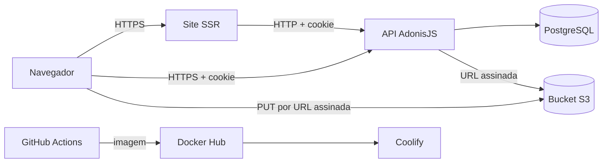

# Segurança

**Interclasse** · como avisar de uma falha, o que se protege, de quem, e como

> O modelo de ameaças (§2) é ancorado em evidência: cada fronteira, superfície e abuso aponta um
> caminho do repositório. Revisado quando muda fronteira: rota pública nova, integração, upload,
> papel novo (`_standards/documentation.md` §5). Segredo encontrado no caminho é redigido aqui,
> nunca copiado.

## 1. Como reportar uma vulnerabilidade

Não abra issue pública. Escreva para a organização dos jogos com os passos para reproduzir. O
e-mail de contato e o prazo de resposta ainda não foram definidos pelo dono do produto
(`PRD.md` §8, pergunta aberta). Até lá, o canal é o responsável técnico do repositório
`github.com/jhollyfer/interclasse`, por mensagem privada.

## 2. Modelo de ameaças

### 2.1 Escopo e premissas

- Dentro: a API (`backend/`), o site e o painel (`frontend/`), o bucket de arquivos, o banco e o pipeline de deploy (`.github/workflows/`).
- Fora: a conta do Docker Hub, do Coolify e do provedor do bucket (seguem a política de cada provedor); o aparelho de quem usa.
- Premissas: TLS terminado no proxy do Coolify; banco e bucket sem acesso público; bucket privado; produção separada de CI e desenvolvimento.

### 2.2 Componentes, fluxos e fronteiras de confiança

| Fronteira | Entre | O que a protege | Evidência |
|---|---|---|---|
| internet → API | navegador e API | cookie `httpOnly` e `secure`, CORS por allowlist, barreira de origem, limite de requisições no login | `backend/config/cors.ts`, `backend/app/middleware/origin.middleware.ts`, `backend/start/limiter.ts` |
| internet → `/storefront` | público e API | só leitura; nenhum middleware, nenhuma escrita; respostas sem nome de aluno | `backend/start/routes.ts`, `shared/src/responses/storefront/` |
| papel → rota | usuário autenticado e grupo de rotas | `auth()` antes de `role()` no grupo; escopo da turma pela consulta | `backend/start/routes.ts`, `backend/app/repositories/classroom/classroom.lucid.repository.ts` |
| navegador → bucket | upload | URL assinada de curta validade; bucket privado; tamanho conferido no `complete` | `backend/app/services/storage/storage.service.ts`, `backend/app/features/storages/files/` |
| CI → produção | repositório e Coolify | secrets do repositório; deploy só no push para `main`; smoke test confere o SHA | `.github/workflows/main.yml`, `main-deploy-coolify.yml` |

### 2.3 Ativos

| Ativo | Por quê importa | C / I / D | Onde fica | Quem acessa |
|---|---|---|---|---|
| Senha das contas | tomada de conta | C | hash `scrypt` na tabela `users` | ninguém lê; `serializeAs: null` |
| Nome de aluno (menor de idade) | dado pessoal de criança (LGPD) | C | `students`, `enrollment_removals` | organização; conselheiro e representante só da própria turma |
| Nome e e-mail dos usuários | dado pessoal | C | `users` | organização; cada um vê a própria conta |
| Fotos dos jogos | imagem de menores | C, I | bucket privado e `photos` | conselheiro envia; organização aprova; o público vê só as aprovadas |
| Chaves, partidas e placar | resultado oficial dos jogos | I | `brackets`, `matches`, `match_cards` | só a organização escreve |
| Sessão (par de tokens) | acesso ao painel | C, I | cookie e `auth_access_tokens` | o dono da sessão |
| Segredos de produção | `APP_KEY`, banco, bucket, `COOLIFY_TOKEN` | C | painel do Coolify e secrets do repositório | quem opera o deploy |

C = confidencialidade, I = integridade, D = disponibilidade.

### 2.4 Atacante

| Pode | Não pode (premissa) |
|---|---|
| chamar qualquer rota pública do `/storefront` e as de login e refresh | ler o banco ou o bucket diretamente |
| tentar senhas contra `/authentication/sign-in` | interceptar TLS |
| conselheiro ou representante autenticado trocar ids na URL e no corpo | obter o `APP_KEY` |
| conselheiro cadastrar nome de aluno com fórmula de planilha | alterar o repositório ou o pipeline |
| enviar arquivo com tipo diferente do declarado | agir como a organização sem ter a conta |

### 2.5 Superfícies

| Superfície | Como chega | Fronteira | Evidência |
|---|---|---|---|
| login | `POST /authentication/sign-in` | internet → API | `backend/app/features/authentication/sessions/sign-in/` |
| renovação de sessão | `POST /authentication/refresh` (sem `auth()`, pelo cookie de refresh) | internet → API | `backend/start/routes.ts` |
| leitura pública | `GET /storefront/*` | internet → `/storefront` | `backend/app/features/storefront/` |
| upload | `POST /storages`, `:id/complete`, PUT na URL assinada | navegador → bucket | `backend/app/features/storages/files/` |
| lista de atletas | `PUT /advisor/enrollments`, `PUT /representative/enrollments` | papel → rota | `backend/app/features/advisor/enrollments/`, `representative/enrollments/` |
| exportação | `GET /administrator/reports/csv` | papel → rota | `backend/app/features/administrator/reports/reports.csv.ts` |
| documentação da API | `/openapi.json`, `/documentation` | internet → API | `backend/app/middleware/documentation.middleware.ts` |
| deploy | push em `main` | CI → produção | `.github/workflows/main.yml` |

### 2.6 Abusos priorizados

| Id | Abuso | Probabilidade | Impacto | Prioridade | Mitigação | Evidência |
|---|---|---|---|---|---|---|
| TM-001 | conselheiro ler ou alterar aluno e inscrição de turma que não é a dele | média | alto | alta | escopo pela sessão na consulta (`findOwned`); recurso alheio responde 404 | `backend/app/repositories/classroom/classroom.repository.e2e.spec.ts` |
| TM-002 | representante mexer na lista depois do sorteio, ou fora da turma | média | alto | alta | a entidade `Enrollment` recusa (`ENROLLMENT_LOCKED`); o representante só acrescenta | `backend/app/domain/enrollment/enrollment.entity.unit.spec.ts` |
| TM-003 | trancar o login de todos errando a senha de qualquer IP (limite por IP vira global atrás do proxy) | alta | médio | alta | aberto: SEC-1 (§10) | `backend/start/limiter.ts` |
| TM-004 | fórmula de planilha em nome de aluno executar no Excel da organização | média | médio | média | CSV prefixa `'` nas células que começam com `=`, `+`, `-`, `@`, tab ou retorno | `backend/app/features/administrator/reports/export/export.unit.spec.ts` |
| TM-005 | foto imprópria aparecer no site público | média | alto | alta | foto do conselheiro nasce `PENDING`; o site lista só `APPROVED` | `backend/app/domain/photo/photo.entity.unit.spec.ts`, `photo.lucid.repository.ts` |
| TM-006 | arquivo que não é PDF ou imagem passar por regulamento ou foto | média | médio | média | `REGULATION_NOT_PDF` e `PHOTO_NOT_IMAGE` no domínio; lista fechada de mimetype sem SVG; tamanho real conferido no bucket | `shared/src/enums/storage-mimetype.ts`, `backend/app/features/storages/files/complete/` |
| TM-007 | escrita anônima pelo site público | baixa | alto | média | o grupo `/storefront` só tem `GET`; `authz:check` reprova mudança na cadeia de autorização contra o baseline | `backend/start/routes.ts`, `backend/scripts/authz-check.ts` |
| TM-008 | enumerar contas pelo login | baixa | baixo | baixa | mesmo 401 `INVALID_CREDENTIALS` para senha errada, conta arquivada e inativa | `backend/app/features/authentication/sessions/sign-in/` |
| TM-009 | encher o disco temporário com multipart anônimo | média | médio | média | aberto: SEC-2 (§10) | `backend/config/bodyparser.ts` |
| TM-010 | POST cross-site com cookie em rota de corpo opcional | baixa | médio | média | aberto: SEC-3 (§10) | `backend/app/middleware/origin.middleware.ts` |
| TM-011 | mensagem crua do banco chegar ao cliente em erro fora de use-case | baixa | médio | média | aberto: SEC-5 (§10) | `backend/app/exceptions/handler.ts` |

### 2.7 Calibragem de criticidade

- Crítico: dado de aluno exposto ao público, ou escrita anônima no banco.
- Alto: tomada de conta de organização; alterar resultado oficial; foto não aprovada no ar.
- Médio: negar o login a todos por um tempo; vazar mensagem interna de erro.
- Baixo: enumerar recurso público; cabeçalho de segurança ausente sem rota de ataque conhecida.

### 2.8 Para revisão manual

- Rota nova no grupo `/storefront`: conferir que a resposta não carrega nome de aluno ou atleta.
- Rota nova com id no caminho: conferir o escopo pela sessão na consulta.
- Texto de usuário que chega ao CSV ou ao HTML: conferir a neutralização.
- Mudança em `COOKIE_DOMAIN`, `CORS_ORIGINS` ou no proxy do Coolify: conferir o cookie e o `sameSite` em produção; `TRUSTED_PROXIES` define quem é o proxy do `request.ip()`.

## 3. Autenticação e sessão

- Sessão por cookie `httpOnly`, `secure` em produção e `sameSite=lax`; cai para `none` só quando o site e a API não compartilham domínio-pai (`backend/app/services/cookie/cookie.service.ts`).
- Par de tokens: acesso de 1 dia e refresh de 7 dias, guardados em `auth_access_tokens`.
- Arquivar a conta, trocar a senha e mudar o papel revogam as sessões no servidor (`SessionService#revokeAll`).
- Limite de tentativas no login: 5 por minuto por IP e 20 por hora por e-mail, bloqueio de 10 minutos, com contagem no banco (`backend/start/limiter.ts`). Os achados SEC-1, SEC-7 e SEC-8 (§10) estão abertos.
- O login responde igual para senha errada, conta arquivada e conta inativa.
- Não há cadastro público nem recuperação de senha: a organização cria as contas.

## 4. Autorização

- Toda rota autenticada passa por `auth()` e `role()` no grupo (`backend/start/routes.ts`); escopo pela sessão (`actor`), nunca por id vindo do cliente.
- Recurso de outro dono responde 404, igual ao inexistente.
- `authz:check` reprova qualquer mudança na cadeia de autorização de uma rota (papel que sai ou entra, `auth()` esquecido) contra um baseline versionado, lido do `openapi.json` (`backend/scripts/authz-check.ts`).
- Perfis: tabela em `ARCHITECTURE.md` §8.

## 5. Entrada e saída

- Todo dado de fora passa pelo validator VineJS (`backend/app/validators/`) antes de chegar à regra.
- Upload: lista fechada de mimetype (imagens, PDF e áudio, sem SVG), teto por arquivo em `UPLOAD_MAX_SIZE`, tamanho real conferido no bucket ao completar. O binário não passa pela API.
- Arquivo só se apaga órfão: a referência viva decide (`STORAGE_IN_USE`).
- CSV com BOM, `;` e neutralização de fórmula (`DECISIONS.md` #5).
- Resposta de erro segue o envelope `{ message, status, code }`; o achado SEC-5 (§10) trata o erro fora de use-case.

## 6. Segredos

- Só em variável de ambiente (`ENV.md`); nada de segredo no código, log ou `docs/`. O logger redige senha, token e cookie (`backend/config/logger.ts`).
- Secrets do repositório: `DOCKERHUB_USERNAME`, `DOCKERHUB_TOKEN`, `COOLIFY_TOKEN`.
- Rotação: não definida. Trocar `APP_KEY` invalida o que ela cifra; trocar `STORAGE_KEY` e `STORAGE_SECRET` exige atualizar o painel do Coolify e reiniciar a API. Procedimento por segredo fica como tarefa aberta (§10).

## 7. Dependências

- Versão mais nova publicada (`_standards/tooling.md` §0); CVE corrigido assim que sai.
- O CI roda lint, typecheck, `openapi:generate --check --strict`, `pattern:check`, `authz:check`, testes e `di:check` no backend, e lint, typecheck, testes e build no frontend. Não há `pnpm audit` nem varredura de segredo no CI.

## 8. Dados pessoais (LGPD)

| Dado | Finalidade | Base legal | Retenção | Exclusão |
|---|---|---|---|---|
| Nome do aluno | montar a lista de atletas e os cartões | a confirmar com a escola (aluno é menor de idade) | enquanto o aluno estiver na turma | conselheiro apaga o aluno; recusa se joga modalidade já sorteada |
| Nome do aluno em `enrollment_removals` | aviso à organização com motivo | a confirmar com a escola | copiado no aviso e mantido mesmo se o aluno sair | não há exclusão pela interface |
| Nome, e-mail e senha (hash) de usuário | login e identificação no painel | execução da atividade escolar | enquanto a conta existir | arquivar (revoga a sessão), desarquivar, excluir |
| Foto enviada pelo conselheiro | carrossel do site | a confirmar com a escola (imagem de menores) | até a organização apagar | organização ou o autor apagam (`DELETE` de foto) |

A base legal e a política de imagem de menores dependem da escola e ficam abertas (§10).

## 9. Checklist de revisão

- [ ] Rota nova tem auth e policy; rota pública nova, integração, upload ou papel atualizou o §2.
- [ ] Nenhum segredo no diff.
- [ ] Entrada validada; saída sem dado de outro usuário e sem nome de aluno no `/storefront`.
- [ ] Log sem senha, token, documento ou outro dado pessoal.
- [ ] Texto de usuário que vai para CSV ou planilha passa pela neutralização.

## 10. Achados abertos

Origem: `maiyu-pattern/_findings/interclasse.md`, auditoria focada de 2026-10-14, reconferida no
código em 2026-10-29. Status: **aberto** (confirmado no código), **a confirmar** (não reconferido).

| # | Severidade | Onde | O que acontece | Correção | Status |
|---|---|---|---|---|---|
| SEC-1 | alta | `backend/config/app.ts`, `backend/start/limiter.ts` | sem `trustProxy`, atrás do Traefik do Coolify `request.ip()` é o IP do proxy; o teto de login por IP (5 por minuto, bloqueio de 10 minutos) e o de upload viram globais, e cinco senhas erradas de qualquer pessoa trancam o login de todos | `trustProxy` pela topologia real, com `TRUSTED_PROXIES` no ENV (`_standards/backend.md` §4.10) | corrigido: `trustProxy` por `TRUSTED_PROXIES`; falta definir o valor no Coolify |
| SEC-2 | média | `backend/config/bodyparser.ts` | nenhuma rota recebe multipart, mas o bodyparser processa `multipart/form-data` em toda rota, com `autoProcess: true` e `limit: '20mb'`; `POST /authentication/refresh` é anônima e sem limite | `autoProcess: false` ou `multipart.limit` mínimo; teto de corpo por grupo | corrigido: `multipart.autoProcess: false` e teto de 1 MB em JSON e formulário |
| SEC-3 | média | `backend/app/middleware/origin.middleware.ts`, `backend/app/services/cookie/cookie.service.ts` | a barreira de origem confere só `multipart/form-data` e `application/x-www-form-urlencoded`, sem `text/plain`; o `sameSite` cai para `none` com `CORS_ORIGINS` vazio ou sem domínio-pai em comum | barreira em todo método diferente de GET e HEAD; `sameSite: 'lax'` fixo; `CORS_ORIGINS` obrigatório em produção | corrigido: barreira em todo método fora de GET/HEAD/OPTIONS, `sameSite: lax` fixo em `config/cookie.ts`; renomear `CORS_ORIGIN` para `CORS_ORIGINS` no Coolify |
| SEC-4 | média | `backend/app/exceptions/handler.ts` | o handler não trata a exceção do limiter: o 429 sai no formato da biblioteca, sem `code` estável e sem log do bloqueio | ramo no handler com `HTTPException.TooManyRequests` e `logger.warn` com tag e chave, sem e-mail em claro | corrigido: 429 `TOO_MANY_REQUESTS` e `logger.warn` com a tag `[security > rate_limited]` |
| SEC-5 | média | `backend/app/exceptions/handler.ts` | erro desconhecido fora de use-case cai em `super.handle`; em produção a mensagem crua (do `pg`, com tabela e constraint) sai fora do envelope | ramo final: status 500 ou mais sem `HTTPException` vira `InternalServerError` genérico, com o erro só no log | corrigido: status 500 ou mais sem `HTTPException` vira `SERVER_ERROR` genérico |
| SEC-6 | baixa | `backend/start/limiter.ts`, `backend/start/routes.ts` | `uploadThrottle` conta por IP e vale para o grupo `storages` inteiro, leituras incluídas: a biblioteca de arquivos gasta a cota de upload, e usuários atrás do mesmo NAT (a escola) a dividem | `usingKey` pelo id do usuário e limite só em `POST /` e `:id/parts` | corrigido: limite por usuário só em `POST /storages`, `:id/complete` e `:id/parts` |
| SEC-7 | baixa | `backend/start/limiter.ts` | a chave por conta usa `request.input('email')` sem `trim()` nem minúsculas | normalizar o e-mail na chave | corrigido: e-mail com `trim` e minúsculas em `LimiterKey.account` |
| SEC-8 | baixa | `backend/start/routes.ts` | `POST /authentication/refresh` escreve sem sessão e sem limite; sem força bruta prática (token opaco), fica o custo da consulta | limite leve por IP | corrigido: `refreshThrottle` (30 por minuto, por IP) |
| SEC-9 | baixa | `frontend/vite.config.ts` | o site SSR (painel incluso) sai sem cabeçalho anti-framing nem CSP: clickjacking no painel | cabeçalhos por `routeRules` do Nitro; registrar a regra no upstream (`_standards/frontend.md`), que hoje não cobre | aberto: regra não coberta pela régua |

Outros itens abertos de segurança e privacidade, sem achado no arquivo de origem:

| Item | Status |
|---|---|
| e-mail de contato e prazo de resposta (§1) | aberto, depende do dono do produto |
| base legal e política de imagem de menores (§8) | aberto, depende da escola |
| procedimento de rotação por segredo (§6) | aberto |
| `pnpm audit` e varredura de segredo no CI (§7) | aberto |

O arquivo de origem não registra mais nenhum achado de segurança fora de SEC-1 a SEC-9. Os itens
B1 a B4, I1 a I5, T1 a T4 e C1 a C6 do mesmo arquivo são de qualidade e estão em `TASKS.md` (3.1).
