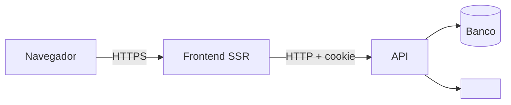

# Segurança

**<Projeto>** · como avisar de uma falha, o que se protege, de quem, e como

> O modelo de ameaças (§2) é ancorado em evidência: cada fronteira, superfície e abuso aponta um
> caminho do repositório. Revisado quando muda fronteira: rota pública nova, integração, upload,
> papel novo (`_standards/documentation.md` §5). Segredo encontrado no caminho é redigido aqui,
> nunca copiado.

## 1. Como reportar uma vulnerabilidade

Não abra issue pública. Escreva para <e-mail de segurança> com passos para reproduzir.
Resposta em até <N> dias úteis.

## 2. Modelo de ameaças

### 2.1 Escopo e premissas

- Dentro: <apps, ambientes e integrações cobertos>.
- Fora: <o que não se analisa aqui e por quê>.
- Premissas: <ex.: TLS terminado no proxy; banco sem acesso público>. Runtime de produção se
  separa de CI e de desenvolvimento.

### 2.2 Componentes, fluxos e fronteiras de confiança

| Fronteira | Entre | O que a protege | Evidência |
|---|---|---|---|
| <internet → API> | <navegador e API> | <cookie httpOnly, CSRF por Origin, rate limit> | `<caminho no repositório>` |

### 2.3 Ativos

| Ativo | Por quê importa | C / I / D | Onde fica | Quem acessa |
|---|---|---|---|---|
| <senha> | <tomada de conta> | C | hash (<scrypt/argon2>) no banco | ninguém lê |
| <e-mail, telefone> | dado pessoal (LGPD) | C | tabela `users` | o próprio usuário, admin |
| <arquivos enviados> | <…> | C, I | <bucket privado, leitura por URL assinada curta> | <…> |
| <log de auditoria> | <prova do que aconteceu> | I | <…> | <…> |

C = confidencialidade, I = integridade, D = disponibilidade.

### 2.4 Atacante

| Pode | Não pode (premissa) |
|---|---|
| <criar conta e chamar qualquer rota pública> | <ler o banco diretamente> |
| <trocar ids na URL e no corpo> | <interceptar TLS> |

### 2.5 Superfícies

| Superfície | Como chega | Fronteira | Evidência |
|---|---|---|---|
| <login> | <`POST /authentication/sessions`> | <internet → API> | `<caminho>` |
| <upload> | <URL pré-assinada> | <navegador → bucket> | `<caminho>` |

### 2.6 Abusos priorizados

| Id | Abuso | Probabilidade | Impacto | Prioridade | Mitigação | Evidência |
|---|---|---|---|---|---|---|
| TM-001 | <ler registro de outro dono trocando o id> | <média> | <alto> | <alta> | <escopo de posse na consulta; 404 igual ao inexistente> | `<caminho do teste>` |

### 2.7 Calibragem de criticidade

<O que é crítico, alto, médio e baixo neste projeto, ex.: crítico = dinheiro ou dado de outro
cliente; baixo = enumeração de recurso público.>

### 2.8 Para revisão manual

- <ponto que nenhuma ferramenta pega e precisa de olho humano a cada mudança>

## 3. Autenticação e sessão

- <Sessão por cookie `httpOnly`, `secure`, `sameSite=lax` | token…>
- <Expiração; logout, troca de senha e mudança de papel invalidam a sessão no servidor>
- <Limite de tentativas em login e recuperação de senha>
- <Login, recuperação e convite respondem igual para conta que existe e que não existe>

## 4. Autorização

- Toda rota autenticada passa por policy (`_standards/backend.md` §4.6); escopo pela sessão
  (`actor`), nunca por id vindo do cliente.
- Recurso de outro dono responde 404, igual ao inexistente.
- Perfis: <tabela perfil × ação ou ponteiro para `ARCHITECTURE.md` §8>.

## 5. Entrada e saída

- Todo dado de fora passa pelo validator VineJS antes de chegar à regra.
- Upload: <tipos aceitos, tamanho máximo fixado na assinatura, varredura>.
- Resposta de erro não vaza stack, SQL ou caminho interno.

## 6. Segredos

- Só em variável de ambiente (`ENV.md`); nada de segredo no código, log ou `docs/`.
- Rotação por segredo: <qual, quem, quando, como, e a leitura da versão anterior durante a troca>.

## 7. Dependências

- Versão mais nova publicada (`_standards/tooling.md` §0); CVE corrigido assim que sai.
- <`pnpm audit` no CI / Dependabot / varredura de segredo>.

## 8. Dados pessoais (LGPD)

| Dado | Finalidade | Base legal | Retenção | Exclusão |
|---|---|---|---|---|
| <e-mail> | <login e aviso de pedido> | <execução de contrato> | <enquanto a conta existir> | <soft delete + anonimização em N dias> |

## 9. Checklist de revisão

- [ ] Rota nova tem auth e policy; rota pública nova, integração, upload ou papel atualizou o §2.
- [ ] Nenhum segredo no diff.
- [ ] Entrada validada; saída sem dado de outro usuário.
- [ ] Log sem senha, token, documento ou outro dado pessoal.
